<div align="center">

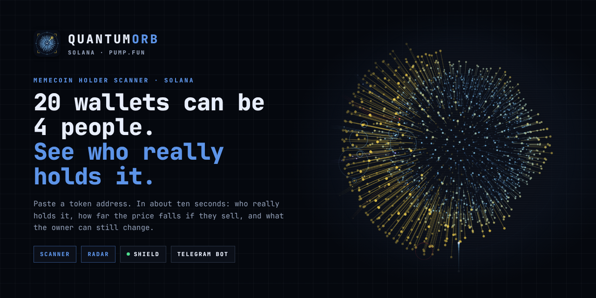

# QuantumOrb

**A memecoin holder scanner for Solana.**<br>
20 wallets can be 4 people. QuantumOrb shows who really holds a token.

[**quantumorb.app**](https://quantumorb.app) · [**Telegram bot**](https://t.me/QuantumORB_bot) · [Every rule, in plain words](https://quantumorb.app/#how) · [Official token](#official-links-and-the-token)

[](https://github.com/QuantumOrb/QuantOrb/actions/workflows/test.yml)


</div>

---

Paste a token address on [quantumorb.app](https://quantumorb.app). In about ten seconds QuantumOrb reads
the top holders from the chain and tells you who really holds the token, how far the price falls if they
sell, and what the owner can still change. Alongside the scanner, a live Radar watches every new pump.fun
launch and Shield checks who made each one; on a token page Guard goes deeper. The Telegram bot,
[@QuantumORB_bot](https://t.me/QuantumORB_bot), brings the launches, the tokens, the devs and the wallets
you follow to your chat.

<p align="center">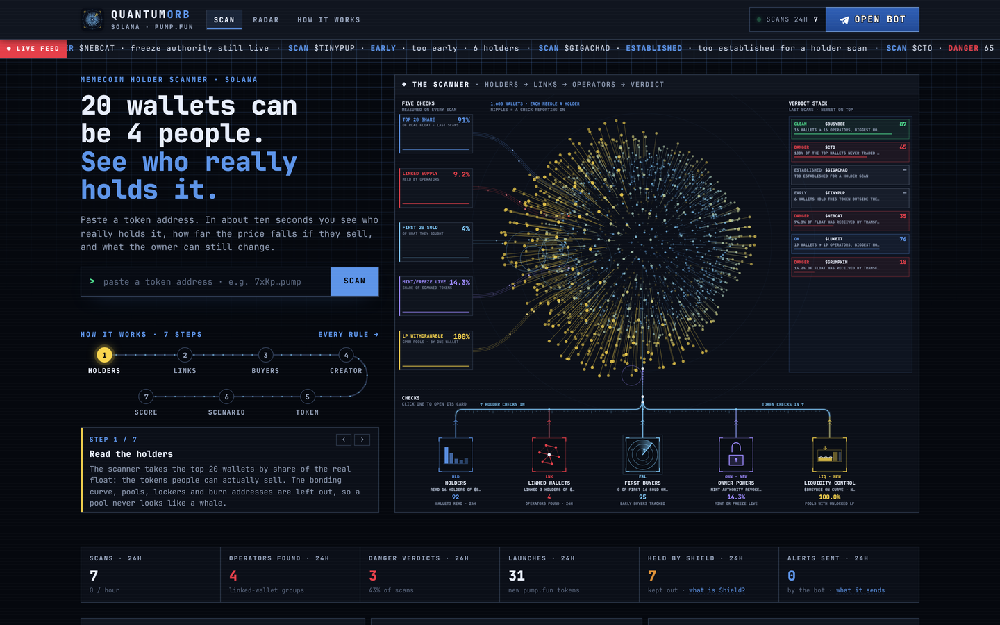</p>

## One scan, three answers

| Question | What the scan reads |
|---|---|
| **Who really holds it?** | The top 20 wallets by share of the real float. The curve, pools, lockers and burn addresses are left out, so a pool never looks like a whale. Wallets that belong together are merged into **operators**. |
| **What happens if they sell?** | A sell scenario: how far the price would fall if the linked, fresh or transferred wallets sold into today's liquidity. |
| **What else can hurt you?** | Owner powers, who can pull the liquidity, the first 20 buyers, and who made the token: Guard's three checks on the dev wallet that signed the launch. |

Every scan ends in a **score from 0 to 100** and a verdict: **CLEAN**, **OK**, **RISKY** or **DANGER**.
Some patterns are too clear for a weighted sum, and they force a red flag whatever the score. When a
token is too young or too established for holder patterns to mean anything, the scanner says so and
gives no score.

<p align="center">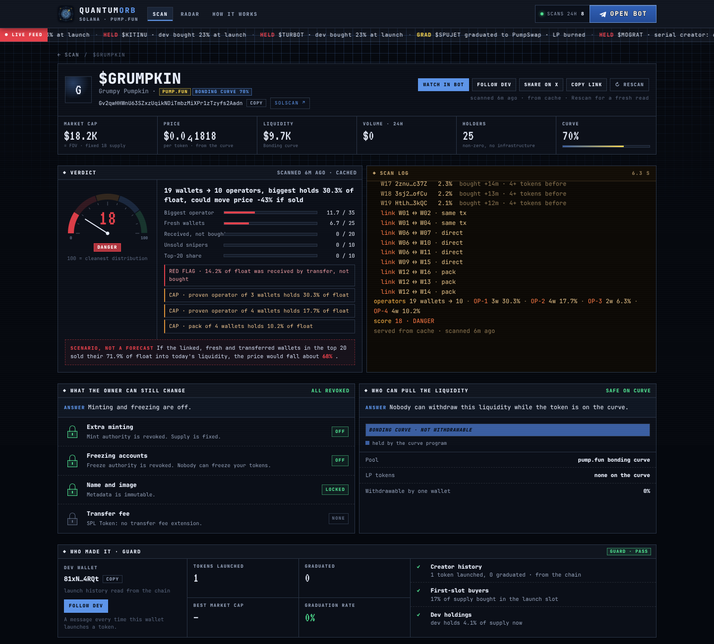<br>
<sub><b>A token page.</b> The verdict and its reasons, the live scan log, what the owner can still change, who can pull the liquidity, and who made it, with Guard. Watch the token or follow its dev in the bot in one click. The market header refreshes every minute while the page is open, and a figure no source knows says N/A, never $0.</sub></p>

<table>
<tr>
<td width="50%" valign="top">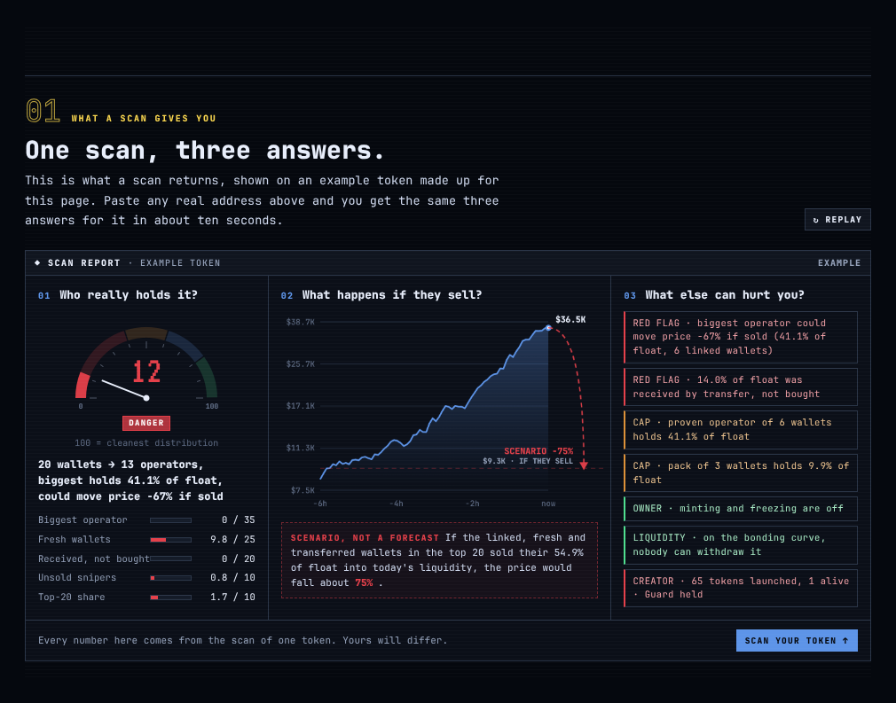<br>
<sub><b>The report.</b> Score, sell scenario and red flags side by side.</sub></td>
<td width="50%" valign="top">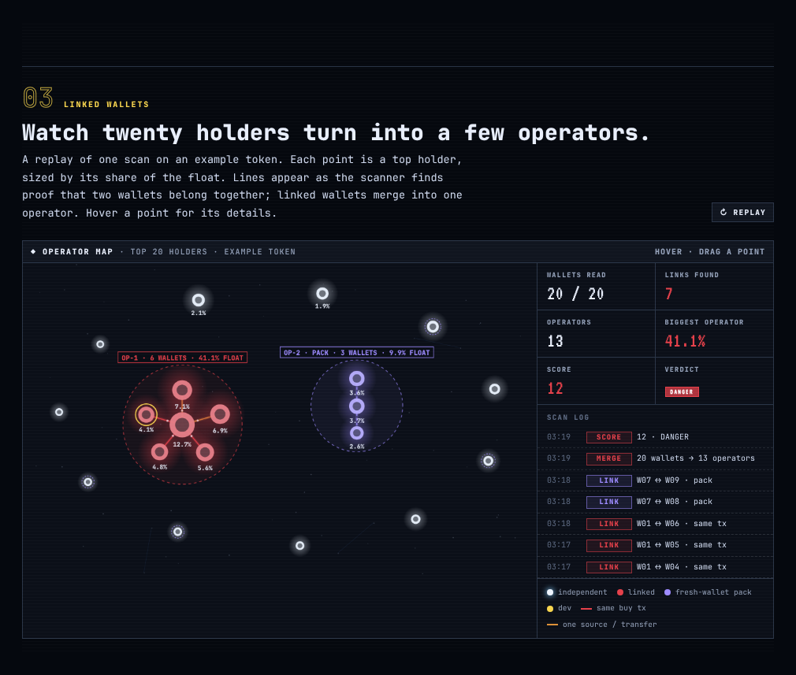<br>
<sub><b>Operators.</b> Twenty holders collapse into a few operators as the scanner finds proof that wallets belong together.</sub></td>
</tr>
</table>

## Five checks behind every verdict

<p align="center">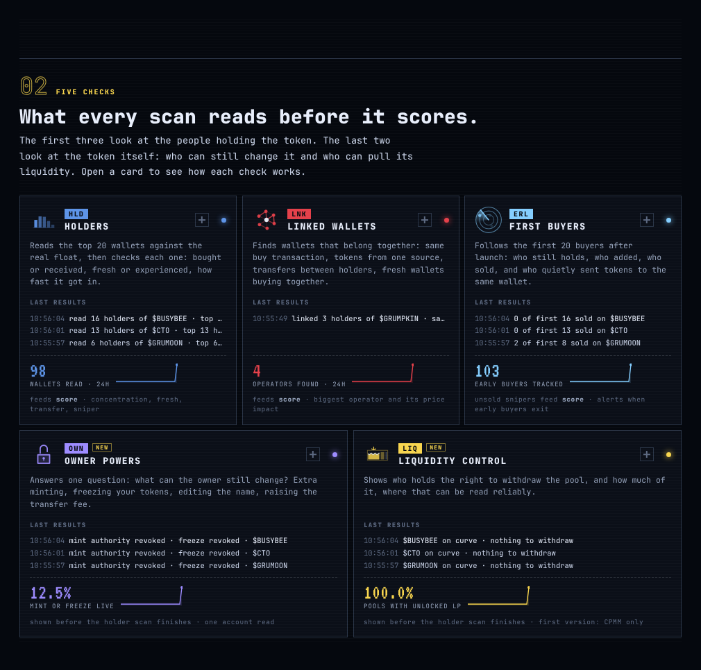</p>

| Check | What it reads |
|---|---|
| **Holders** | The top 20 wallets by share of the real float: bought or received, fresh or experienced (from none to 100+ tokens traded before), how fast they got in |
| **Linked wallets** | Wallets that act as one: the same buy transaction, tokens from one source, transfers between holders, packs of fresh wallets |
| **First buyers** | All of the first 20 buyers after launch, even behind a bundle that trades with itself, and what each did since: holding, added, sold, sent to the same wallet |
| **Owner powers** | Mint and freeze authority, mutable metadata, Token-2022 transfer fees |
| **Liquidity control** | Who holds the right to withdraw the pool, and how much of it |

The score is a fixed, written set of rules, not a black box. Every weight, threshold and red flag is
published on the site, [quantumorb.app/#how](https://quantumorb.app/#how), and rule by rule with the code in
[`docs/scoring.md`](docs/scoring.md).

<p align="center">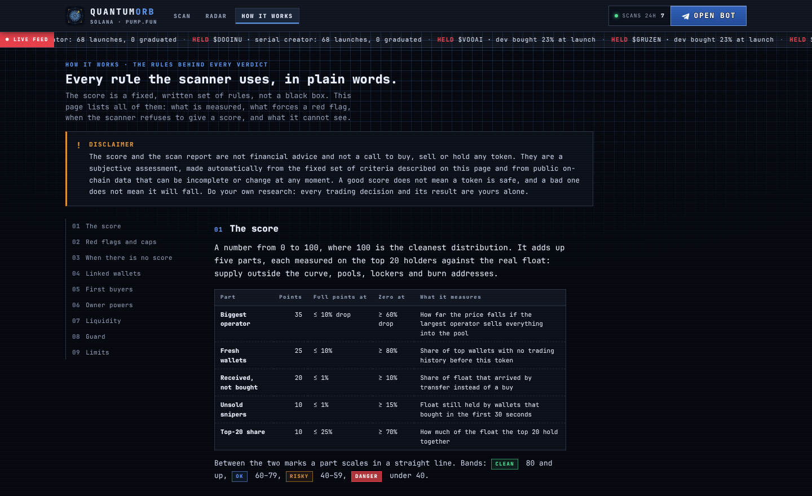</p>

## Radar, Shield and Guard

New pump.fun launches appear on the Radar seconds after they go live. It keeps the last 1,000, about the
last hour, and your filters run over all of them: market cap, curve progress, socials, keywords. Send the
filters to the bot to get the same feed in Telegram.

Before you see a launch, **Shield** checks who made it, on free public data:

- **Creator history** · every pump.fun launch of the dev wallet, read from the chain once the launch
  reaches 10% of its curve or 20 buyers. 10 or more launches with under 10% graduated is a serial creator.
- **Dev at launch** · how much of the supply the dev bought in the launch itself. 15% or more is held.

On a token page and in every scan, **Guard** goes deeper with three checks: the creator's launches,
how much supply was bought in the launch slot, and how much the dev still holds now. Either way a launch
is held back only on evidence, the reason is always shown, and a check that could not be read says so:
it is never a silent pass.

<p align="center">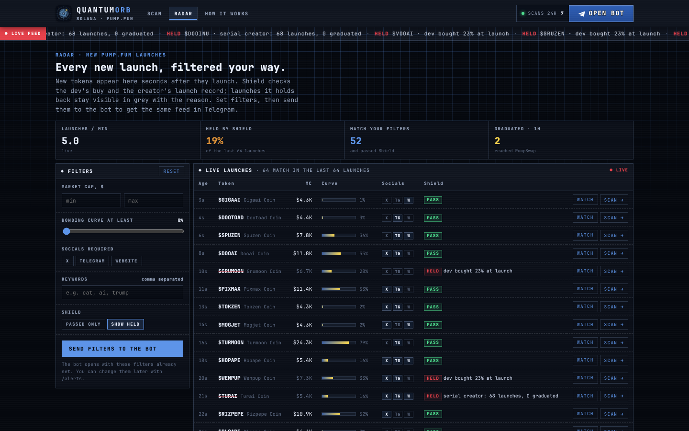</p>

<table>
<tr>
<td width="50%" valign="top">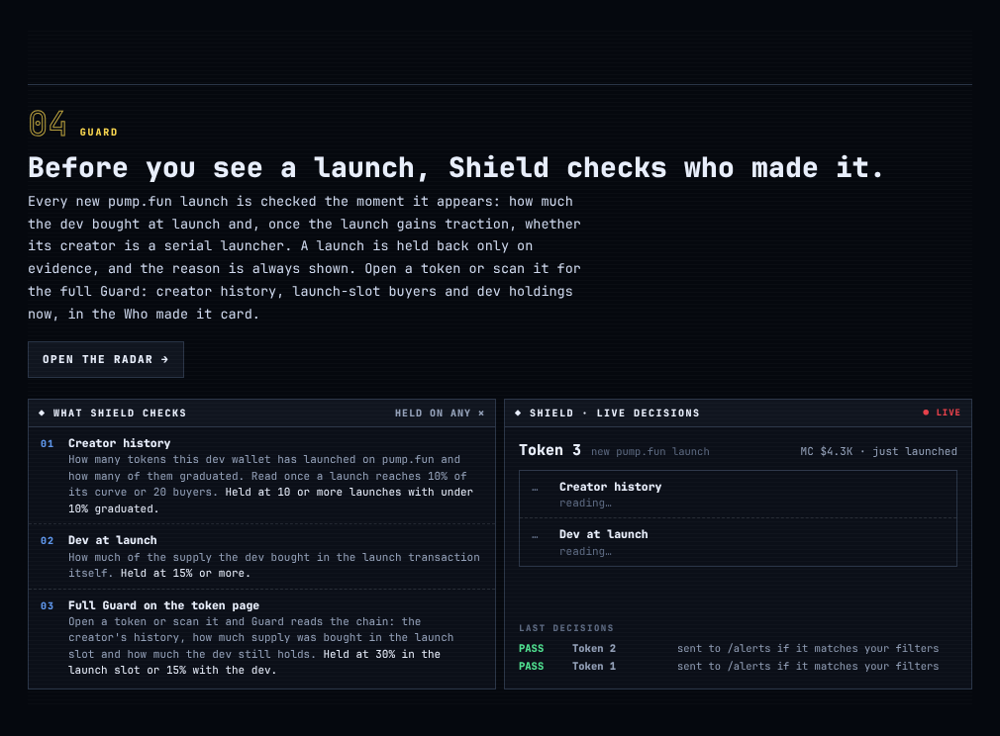<br>
<sub><b>Shield.</b> Two checks on every launch, live decisions as they happen. A launch that passes goes on to <code>/alerts</code> in the bot if it matches your filters.</sub></td>
<td width="50%" valign="top">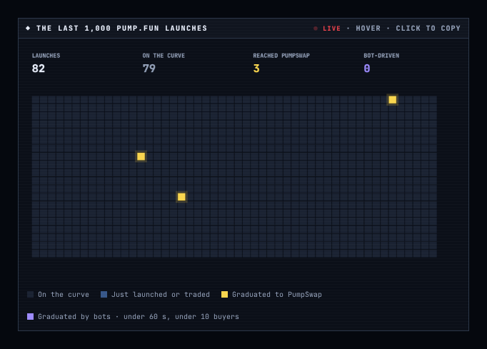<br>
<sub><b>The last 1,000 launches.</b> Each new token flashes in where the oldest one was. Few ever reach a pool.</sub></td>
</tr>
</table>

## The Telegram bot

**[@QuantumORB_bot](https://t.me/QuantumORB_bot)** · free for everybody.
The site tells you what a token is. The bot tells you when it changes.

<p align="center">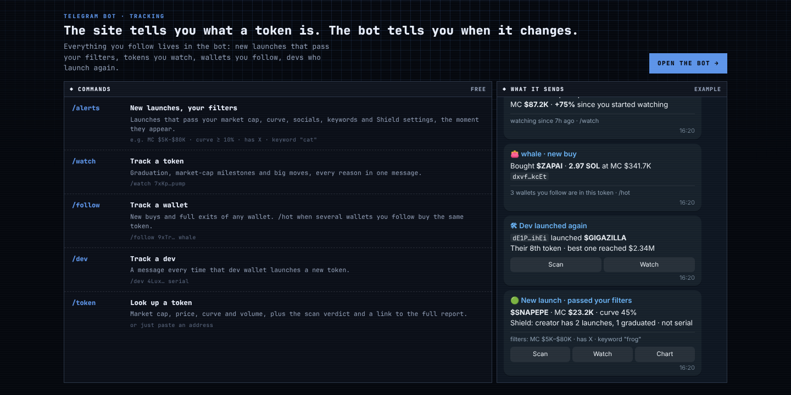</p>

| Command | What it does |
|---|---|
| `/alerts` | New pump.fun launches the moment they pass **your** filters: market cap, bonding-curve progress, required socials, SOL pairs only, keywords |
| `/watch` | Track a token: graduation from the bonding curve, market-cap moves up or down, milestones from $10K to $100M |
| `/follow` | Track a wallet: every new position and every full exit |
| `/dev` | Know the second a dev wallet launches a token, with its Shield record |
| `/token` | Any token on demand: market cap, price, curve, volume, buys and sells, price change, the creator and Shield. Or just paste an address |
| `/new` · `/list` | The latest launches, and everything you follow in one place |
| `/scan` | The full scan report in the chat: hidden ownership, wallet clusters, capital flows · *on the roadmap* |

**Shield** checks the creator of every launch before an alert goes out: every pump.fun launch of that
wallet, straight from the chain. A wallet that launches by the dozen and almost never graduates is a
serial creator, and its launches are screened out. The same check comes with every token card and every
dev you follow. New launches reach the bot the moment they happen, with no polling delay.

The messages below are the bot's own, on made-up tokens and wallets.

<table>
<tr>
<td width="50%" valign="top">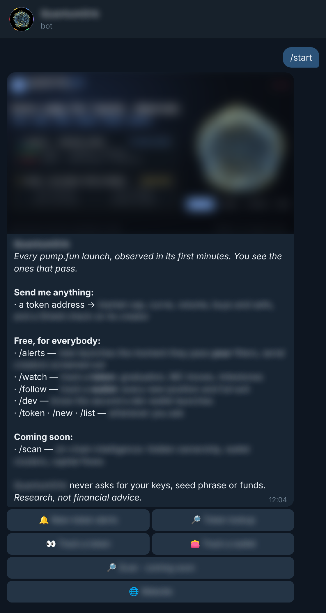<br>
<sub><b>Start.</b> What it does, free for everybody, and what is coming.</sub></td>
<td width="50%" valign="top">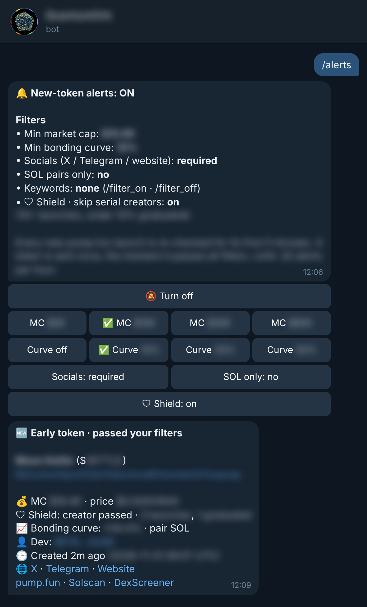<br>
<sub><b>Alerts.</b> Your filters, one tap each, and an early launch that just passed them and Shield.</sub></td>
</tr>
<tr>
<td valign="top">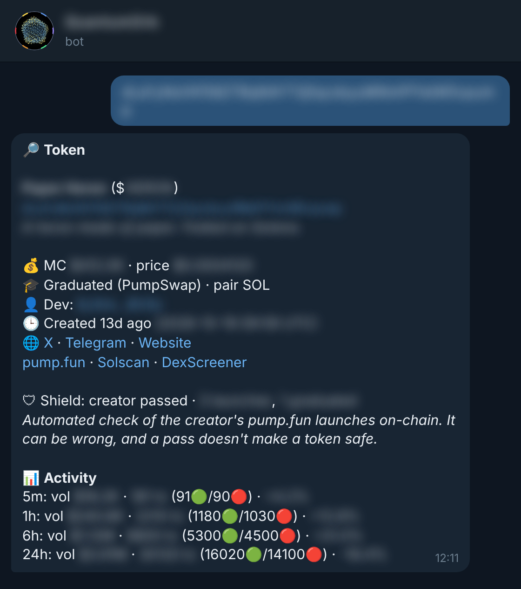<br>
<sub><b>Any token.</b> Send an address, get its card: market, curve, creator, Shield, and buys and sells from 5 minutes to 24 hours.</sub></td>
<td valign="top">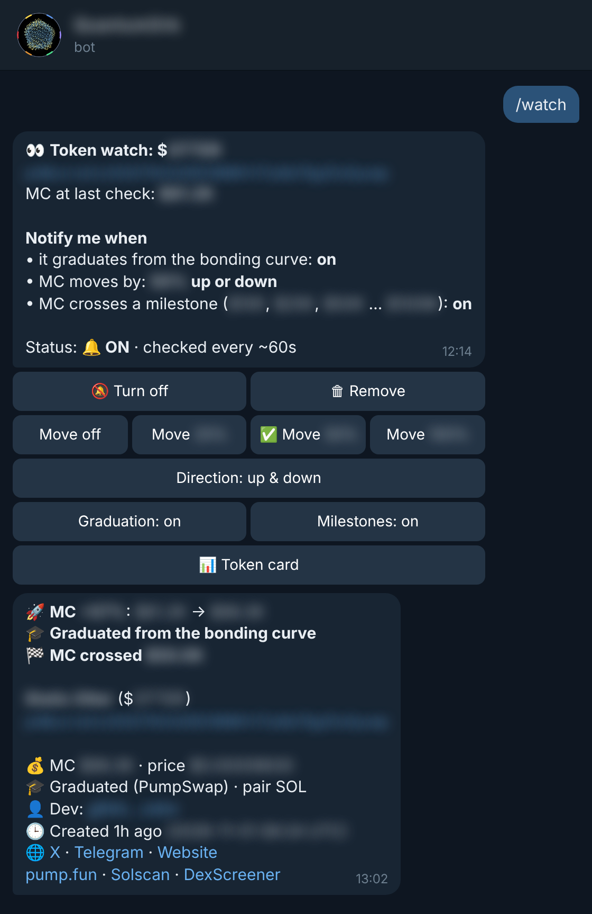<br>
<sub><b>Watch.</b> A token you follow moves, graduates and crosses a milestone: every reason in one message.</sub></td>
</tr>
<tr>
<td valign="top">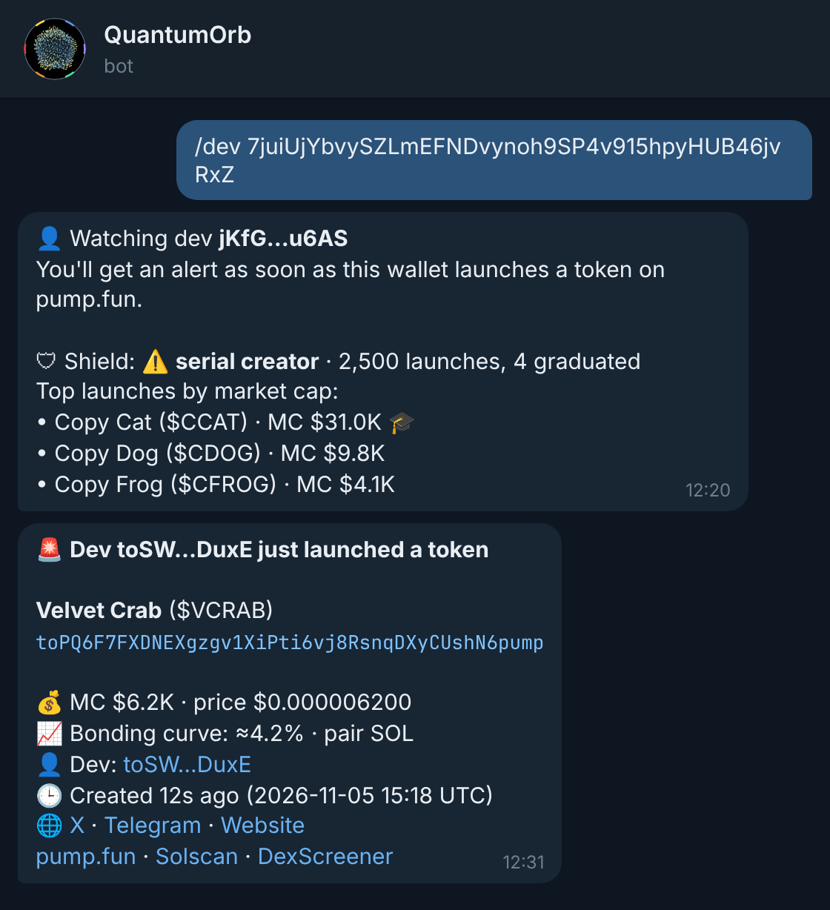<br>
<sub><b>Dev.</b> Shield's record on a serial creator, and the alert the second that wallet launches again.</sub></td>
<td valign="top">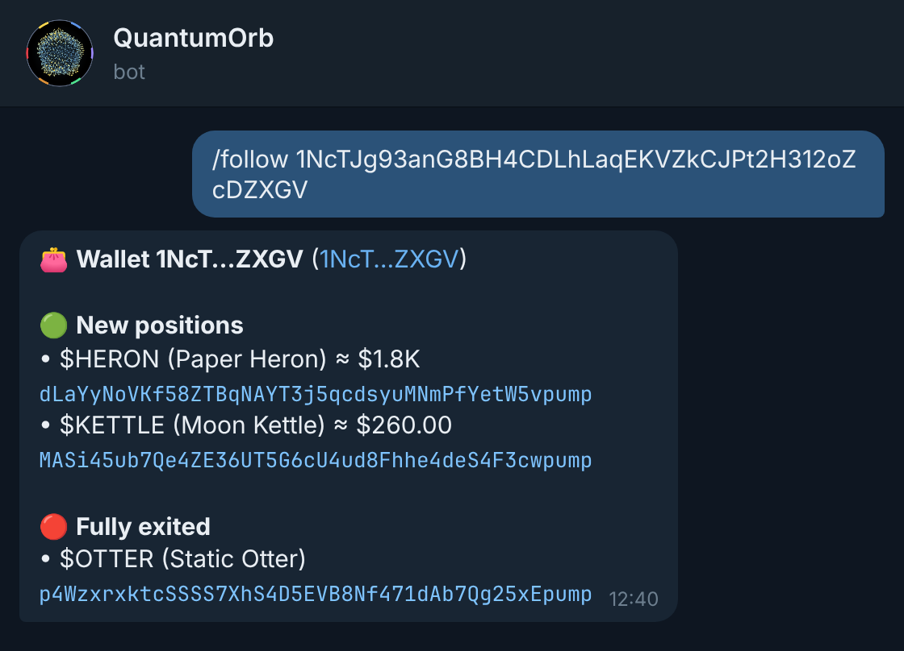<br>
<sub><b>Follow.</b> A wallet you follow opens new positions and fully exits another.</sub></td>
</tr>
</table>

## On your phone

<p align="center">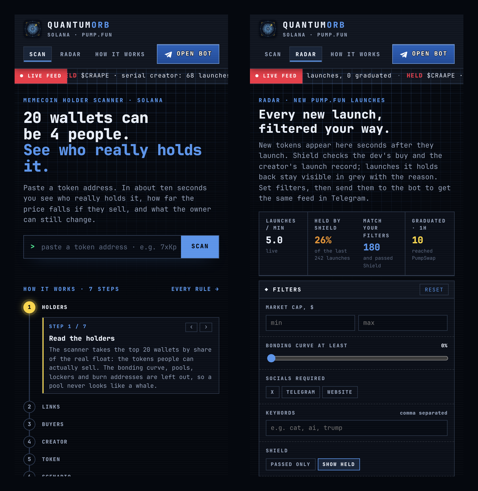</p>

## Roadmap

<p align="center">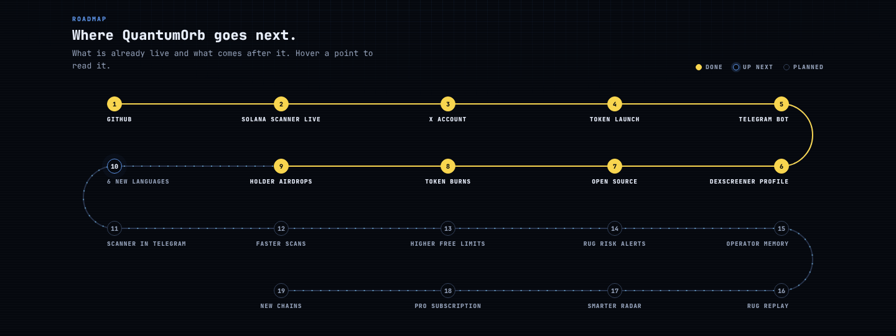</p>

| # | Step | | Status |
|---|---|---|---|
| 1 | **GitHub** | This repository: docs, changelog and issue tracker in one public place | ✅ Done |
| 2 | **Solana Scanner Live** | Top 20 holders, first 20 buyers, linked wallets and a 0–100 risk score for any pump.fun token | ✅ Done |
| 3 | **X Account** | Updates, scan breakdowns and release news | ✅ Done |
| 4 | **Token Launch** | The QuantumOrb token launches on pump.fun | ✅ Done |
| 5 | **Telegram Bot** | Radar alerts by your filters, watched tokens, follow a dev or any wallet | ✅ Done |
| 6 | **DexScreener Profile** | Verified token profile: logo, links and description | ✅ Done |
| 7 | **Open Source** | The scanner's code goes public, so anyone can check how the score is calculated | ✅ Done |
| 8 | **Token Burns** | Part of the token supply is burned | ✅ Done |
| 9 | **Holder Airdrops** | Airdrops for QuantumOrb token holders | ✅ Done |
| 10 | **6 New Languages** | The site in six more languages besides English | 🔵 Up next |
| 11 | **Scanner in Telegram** | Paste a contract into the bot and get the full scan report without opening the site | Planned |
| 12 | **Faster Scans** | Shorter scan times on tokens with large, busy holder lists | Planned |
| 13 | **Higher Free Limits** | More free scans per day | Planned |
| 14 | **Rug Risk Alerts** | An early warning when a scanned token starts to look like a rug: the dev or a linked cluster dumping, tokens pulled into one wallet, LP withdrawn | Planned |
| 15 | **Operator Memory** | Clusters remembered across tokens: where an operator held before and how those tokens ended | Planned |
| 16 | **Rug Replay** | A step-by-step replay of a past rug: who bought first, how the wallets were linked, who sold and when | Planned |
| 17 | **Smarter Radar** | New launches on the Radar arrive already scanned, with their score | Planned |
| 18 | **Pro Subscription** | No scan limits, and a live list of fresh tokens scoring 90+ in the bot | Planned |
| 19 | **New Chains** | The scanner on Robinhood Chain, Base and BNB Chain | Planned |

## Open code

About a tenth of QuantumOrb's code is open here: everything that decides a verdict, and the parts that read
pump.fun and turn market data into the figures on a token page. Each file is the server's or the bot's own
code, not a rewrite, and the tests run it on the server's own results and on real chain addresses.

| Folder | Language | What is open |
|---|---|---|
| [`rules/`](rules) | JavaScript | The score, operators, red flags, caps, the sell scenario, Guard's three checks and Shield's rule |
| [`chain/`](chain) | JavaScript | How the server reads pump.fun and Solana: program ids, derived addresses, curve, pool and metadata layouts, a transaction reader |
| [`market/`](market) | JavaScript | A token page's market figures: which pools belong to the token, which one sets the price, market cap kept apart from FDV, N/A instead of $0 |
| [`bot/`](bot) | Python | Every message the bot sends about a token, Shield's rule, and the bot's own pump.fun curve reader |

### Check the score yourself

```bash
git clone https://github.com/QuantumOrb/QuantOrb && cd QuantOrb
npm test                                        # Node 18+, no dependencies
npm run test:bot                                # Python 3.11+, standard library only
node rules/cli.js examples/site-example.json    # the example token on the home page
```

```
The example token on the QuantumOrb home page · $GRUMPKIN
20 wallets → 13 operators, biggest holds 41.1% of float, could move price −67% if sold

score 12 / 100 · DANGER
  Biggest operator        0.0 / 35
  Fresh wallets           9.8 / 25
  Received, not bought    0.0 / 20
  Unsold snipers          0.8 / 10
  Top-20 share            1.7 / 10
RED FLAG · biggest operator could move price −67% if sold (41.1% of float, 6 linked wallets)
RED FLAG · 14.0% of float was received by transfer, not bought
CAP · proven operator of 6 wallets holds 41.1% of float
CAP · pack of 3 wallets holds 9.9% of float
SCENARIO · if the linked, fresh and transferred wallets sold their 54.9% of float into today's liquidity, the price would fall about 75%
```

Rule by rule: [`docs/scoring.md`](docs/scoring.md) · [`docs/guard.md`](docs/guard.md) (Guard and Shield).

### What stays closed

Which accounts and transactions a scan asks for, in what order and under what budget; finding the links
between wallets; the launch stream; the Radar; the site and its API; the bot's commands, alert loops and
database; every data source's keys, limits and fallbacks; the servers. That is what it takes to run
QuantumOrb, and it is not in this repository. [`docs/architecture.md`](docs/architecture.md) shows where
the line is.

## What is in this repository

| Folder | |
|---|---|
| [`rules/`](rules) | The open rules, and a command that prints a verdict |
| [`chain/`](chain) | The pump.fun and Solana reader |
| [`market/`](market) | The token page's market figures |
| [`bot/`](bot) | The bot's messages, Shield and curve reader, with their tests |
| [`examples/`](examples) | Scan inputs with the verdict each must get: the site's example token, scans the server made, one file per rule |
| [`test/`](test) | `npm test`: every rule at its edges, the examples against the server's results, the chain reader on real addresses, the market figures on real market data |
| [`docs/`](docs) | How QuantumOrb fits together, the score rule by rule, Guard and Shield |
| [`assets/`](assets) | The banner and the screens above |
| [`.github/`](.github) | Issue templates and the test workflow |

What changed and when: [`CHANGELOG.md`](CHANGELOG.md).

## Official links and the token

| | |
|---|---|
| Site | [quantumorb.app](https://quantumorb.app) |
| Telegram bot | [@QuantumORB_bot](https://t.me/QuantumORB_bot) |
| Source and issues | [github.com/QuantumOrb/QuantOrb](https://github.com/QuantumOrb/QuantOrb) |

**The QuantumOrb token** on Solana, launched on pump.fun. The only official contract address:

```
EiN69j8KVE5uYKheVkeVwptEVwRP5JtDhJDMGm1ppump
```

[pump.fun](https://pump.fun/coin/EiN69j8KVE5uYKheVkeVwptEVwRP5JtDhJDMGm1ppump) ·
[DexScreener](https://dexscreener.com/solana/EiN69j8KVE5uYKheVkeVwptEVwRP5JtDhJDMGm1ppump) ·
[Solscan](https://solscan.io/token/EiN69j8KVE5uYKheVkeVwptEVwRP5JtDhJDMGm1ppump)

> [!WARNING]
> Any other contract that calls itself QuantumOrb is not ours. Check the address character by character.
> QuantumOrb never asks for a private key, a seed phrase or funds.

<sub>The token is not an investment product and nothing here is financial advice. Do your own research.</sub>

## Limits

- QuantumOrb only reads public on-chain data. It never asks for keys or seed phrases and never touches funds.
- It sees wallets, not people. Two wallets of one person with no on-chain connection look independent.
- A CLEAN score is not a promise. Liquidity, sentiment and the dev's off-chain plans are outside what it can read.
- Five new scans a day per person. Opening a report again, or reloading the page during a scan, never counts.
- Nothing here is financial advice or a call to buy, sell or hold. The score is an automated, subjective
  assessment by a fixed set of criteria, on public data that can be incomplete.

---

<sub>The screens of the site come from a development build running on a simulated chain, and the bot's
messages are shown on made-up data, so every token, wallet and figure on them is made up.
Found a bug or have an idea? <a href="https://github.com/QuantumOrb/QuantOrb/issues">Open an issue</a>. © 2026 QuantumOrb. All rights reserved.</sub>
