<div align="center">

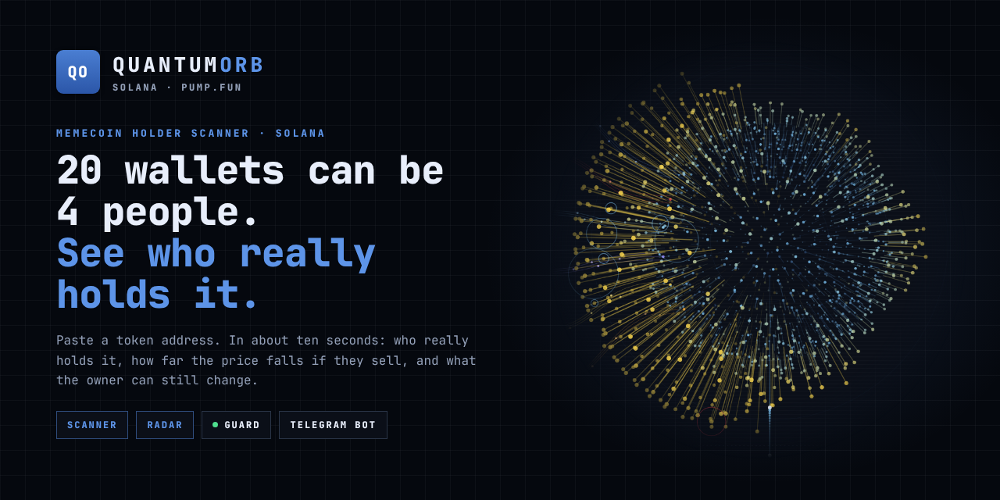

# QuantumOrb

**A memecoin holder scanner for Solana.**<br>
20 wallets can be 4 people. QuantumOrb shows who really holds a token.

[**quantumorb.app**](https://quantumorb.app) · [Every rule, in plain words](https://quantumorb.app/#how) · Telegram bot: coming soon

</div>

---

Paste a token address. In about ten seconds QuantumOrb reads the top holders from the chain and tells
you who really holds the token, how far the price falls if they sell, and what the owner can still
change. Alongside the scanner, a live Radar watches every new pump.fun launch, and Guard checks who
made each one. A Telegram bot that brings all of it to your chat is in closed testing.

<p align="center">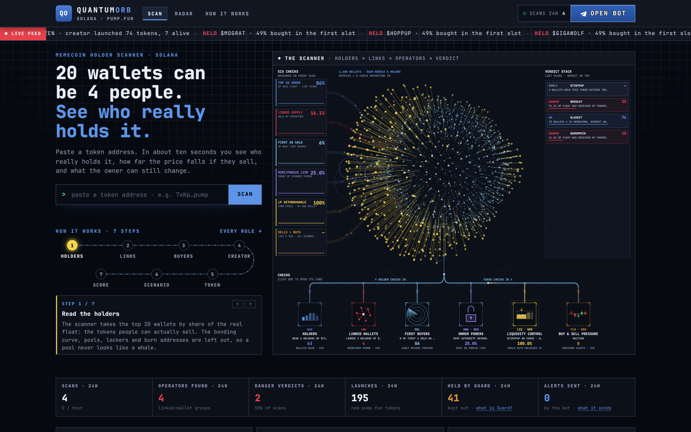</p>

## One scan, three answers

| Question | What the scan reads |
|---|---|
| **Who really holds it?** | The top 20 wallets by share of the real float. The curve, pools, lockers and burn addresses are left out, so a pool never looks like a whale. Wallets that belong together are merged into **operators**. |
| **What happens if they sell?** | A sell scenario: how far the price would fall if the linked, fresh or transferred wallets sold into today's liquidity. |
| **What else can hurt you?** | Owner powers, who can pull the liquidity, the creator's history and live buy and sell pressure. |

Every scan ends in a **score from 0 to 100** and a verdict: **CLEAN**, **OK**, **RISKY** or **DANGER**.
Some patterns are too clear for a weighted sum, and they force a red flag whatever the score. When a
token is too young or too established for holder patterns to mean anything, the scanner says so and
gives no score.

<p align="center">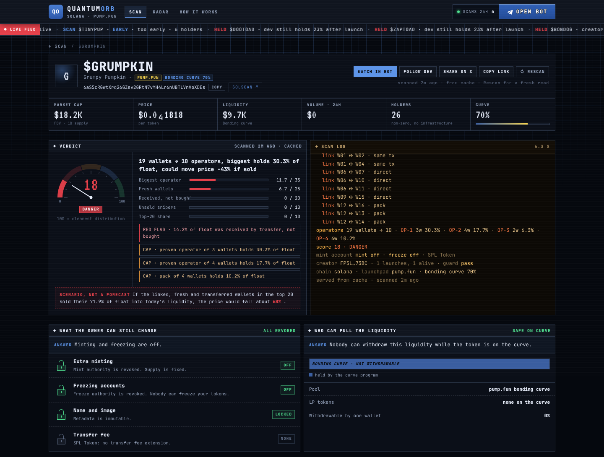<br>
<sub><b>A token page.</b> The verdict and its reasons, the live scan log, what the owner can still change, and who can pull the liquidity.</sub></p>

<table>
<tr>
<td width="50%" valign="top">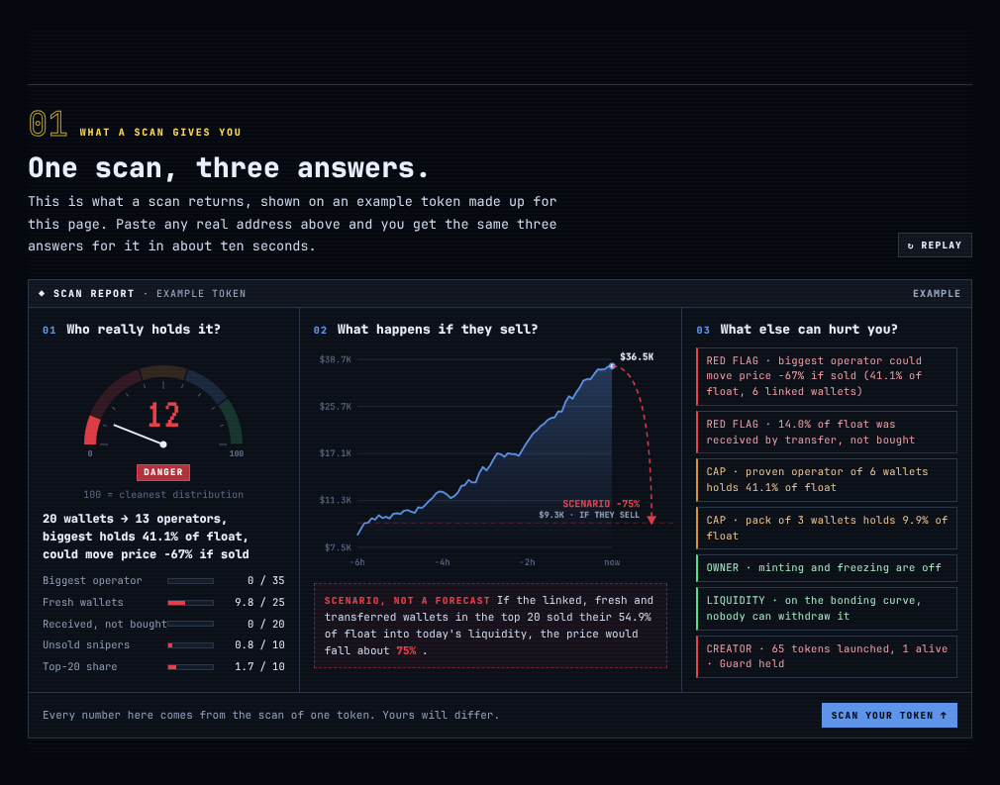<br>
<sub><b>The report.</b> Score, sell scenario and red flags side by side.</sub></td>
<td width="50%" valign="top">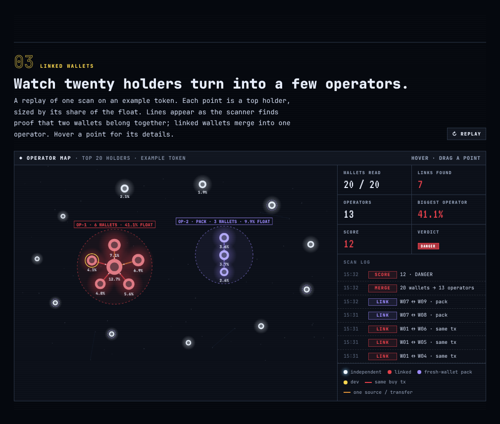<br>
<sub><b>Operators.</b> Twenty holders collapse into a few operators as the scanner finds proof that wallets belong together.</sub></td>
</tr>
</table>

## Six checks behind every verdict

<p align="center">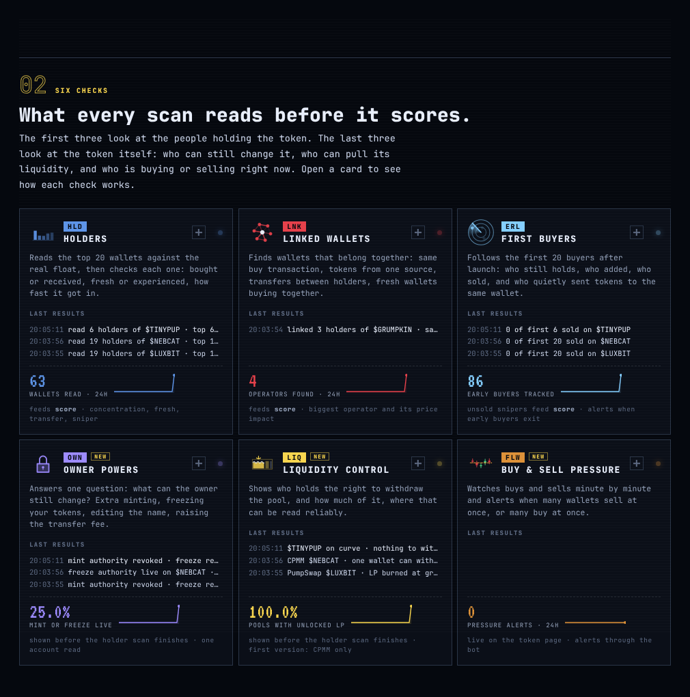</p>

| Check | What it reads |
|---|---|
| **Holders** | The top 20 wallets by share of the real float: bought or received, fresh or experienced, how fast they got in |
| **Linked wallets** | Wallets that act as one: the same buy transaction, tokens from one source, transfers between holders, packs of fresh wallets |
| **First buyers** | The first 20 buyers after launch and what each did since: holding, added, sold, sent to the same wallet |
| **Owner powers** | Mint and freeze authority, mutable metadata, Token-2022 transfer fees |
| **Liquidity control** | Who holds the right to withdraw the pool, and how much of it |
| **Buy & sell pressure** | Buys and sells minute by minute, with alerts when many wallets sell at once |

The score is a fixed, written set of rules, not a black box. Every weight, threshold and red flag is
published on the site: [quantumorb.app/#how](https://quantumorb.app/#how).

<p align="center">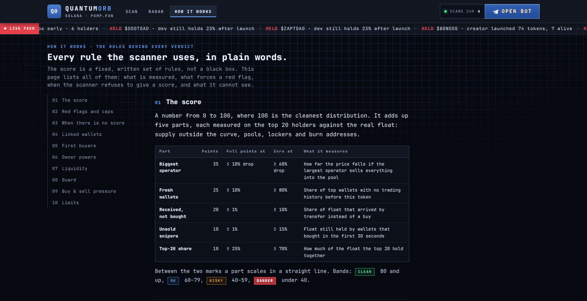</p>

## Check the score yourself

The code that turns a scan into a verdict is open: [`rules/`](rules). The score, operators, red flags,
caps, the sell scenario and Guard's checks are the server's own functions, not a rewrite. The examples
carry results the server itself produced, and the tests hold the open code to them.

```bash
git clone https://github.com/QunatOrb/QuantOrb && cd QuantOrb
npm test                                        # Node 18+, no dependencies
node rules/cli.js examples/site-example.json    # the example token on the home page
```

```
The example token on quantumorb.app · $GRUMPKIN
20 wallets → 13 operators, biggest holds 41.1% of float, could move price −67% if sold

score 12 / 100 · DANGER
  Biggest operator        0.0 / 35
  Fresh wallets           9.8 / 25
  Received, not bought    0.0 / 20
  Unsold snipers          0.8 / 10
  Top-20 share            1.7 / 10
RED FLAG · biggest operator could move price −67% if sold (41.1% of float, 6 linked wallets)
RED FLAG · 14.0% of float was received by transfer, not bought
CAP · proven operator of 6 wallets holds 41.1% of float
CAP · pack of 3 wallets holds 9.9% of float
SCENARIO · if the linked, fresh and transferred wallets sold their 54.9% of float into today's liquidity, the price would fall about 75%
```

Rule by rule: [`docs/scoring.md`](docs/scoring.md) · [`docs/guard.md`](docs/guard.md).

## Radar and Guard

New pump.fun launches appear on the Radar seconds after they go live. Set filters for market cap,
curve progress, socials and keywords, then send them to the bot to get the same feed in Telegram.

Before you see a launch, **Guard** checks who made it: the creator's history, how much supply was
bought in the launch slot, and how much the dev still holds. A launch is held back only on evidence,
and the reason is always shown.

<p align="center">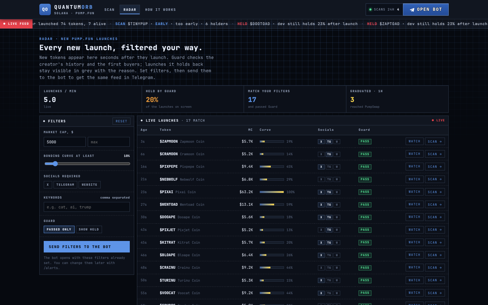</p>

<table>
<tr>
<td width="50%" valign="top">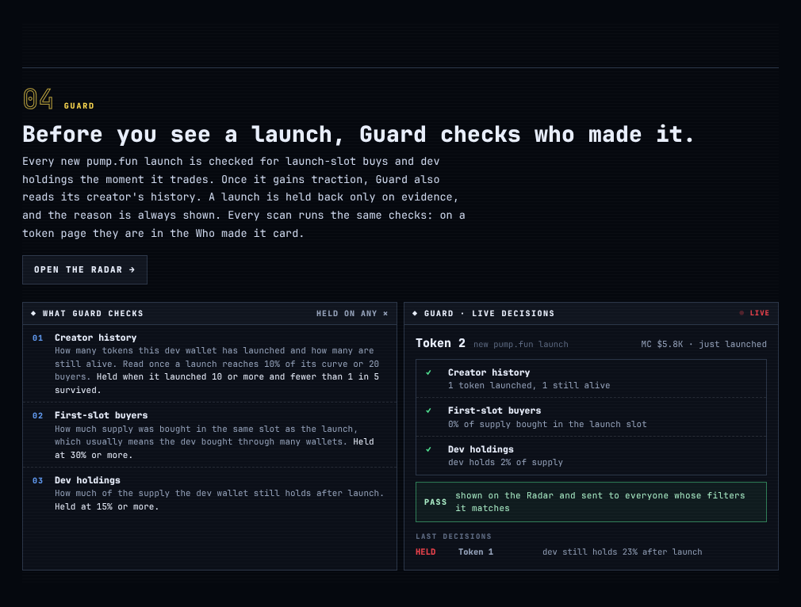<br>
<sub><b>Guard.</b> Three checks on every launch, live decisions as they happen.</sub></td>
<td width="50%" valign="top">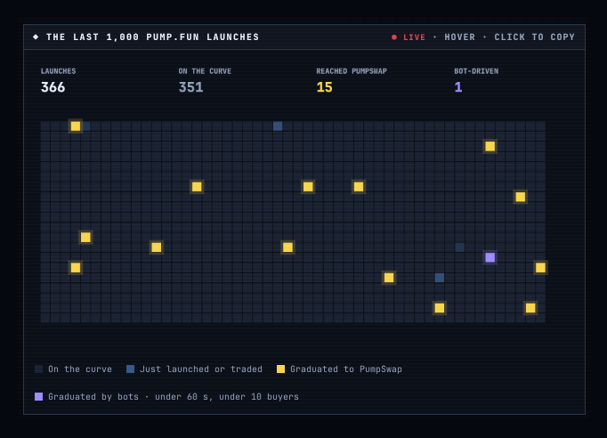<br>
<sub><b>The last 1,000 launches.</b> Each new token flashes in where the oldest one was. Few ever reach a pool.</sub></td>
</tr>
</table>

## The Telegram bot · coming soon

The site tells you what a token is. The bot tells you when it changes. It is in closed testing; its
link will appear here when it opens.

| Command | What it does |
|---|---|
| `/alerts` | New pump.fun launches the moment they pass **your** filters: market cap, bonding-curve progress, required socials, SOL pairs only, keywords |
| `/watch` | Track a token: graduation from the bonding curve, market-cap moves up or down, milestones from $10K to $100M |
| `/follow` | Track a wallet: every new position and every full exit |
| `/dev` | Know the second a dev wallet launches a token, with its record so far |
| `/token` | Any token on demand: market cap, price, ATH, curve, volume and the latest trades. Or just paste an address |
| `/new` · `/list` | The latest launches, and everything you follow in one place |
| `/scan` | On-chain intelligence in the chat: hidden ownership, wallet clusters, capital flows · *coming soon* |

**Shield** checks the creator of every launch before an alert goes out. A wallet that launches by the
dozen and almost never graduates is a serial creator, and its launches are screened out. The same check
comes with every token card and every dev you follow.

<sub>Development build on made-up data. The bot's name, the names of coins and wallets, addresses,
figures and the descriptions are hidden until it opens.</sub>

<table>
<tr>
<td width="50%" valign="top">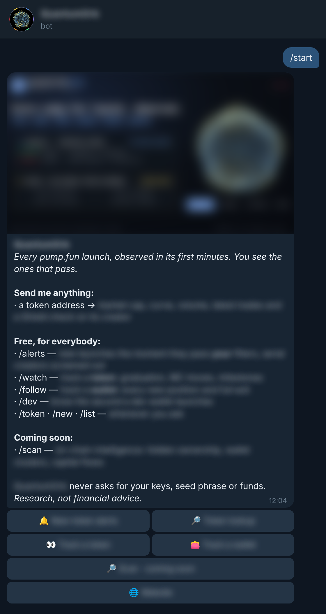<br>
<sub><b>Start.</b> What it does, free for everybody, and what is coming.</sub></td>
<td width="50%" valign="top">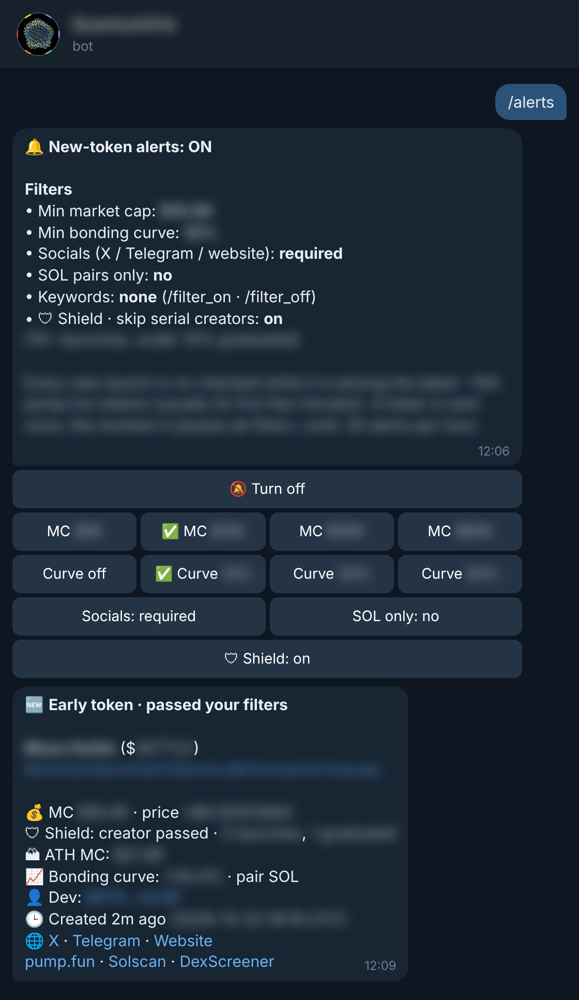<br>
<sub><b>Alerts.</b> Your filters, one tap each, and an early launch that just passed them and Shield.</sub></td>
</tr>
<tr>
<td valign="top">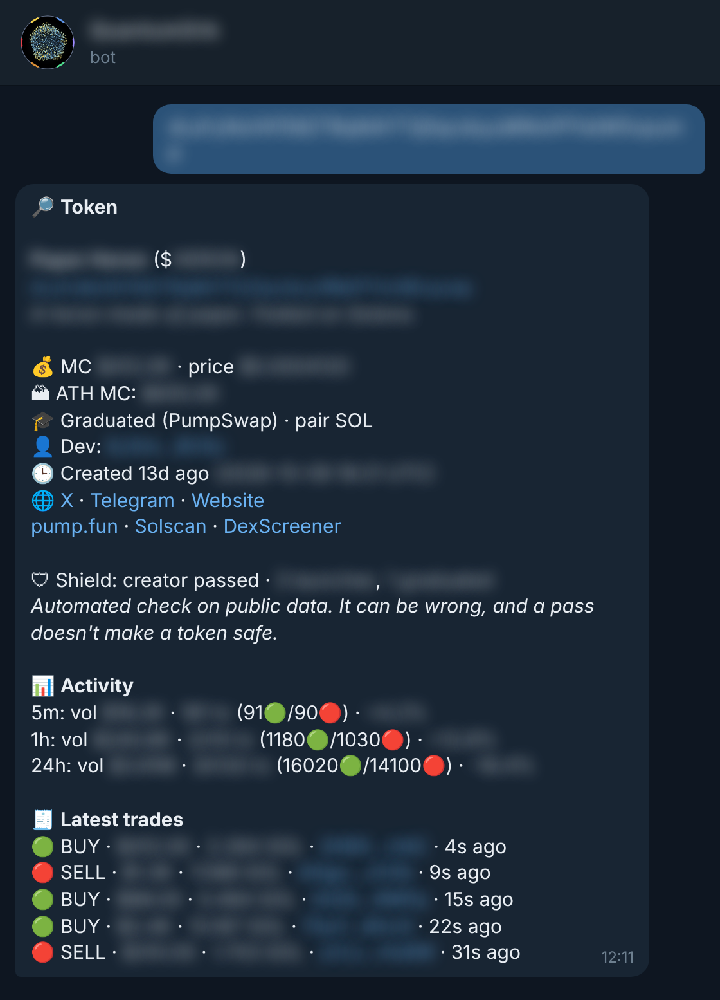<br>
<sub><b>Any token.</b> Send an address, get its card: market, curve, creator, activity and the latest trades.</sub></td>
<td valign="top">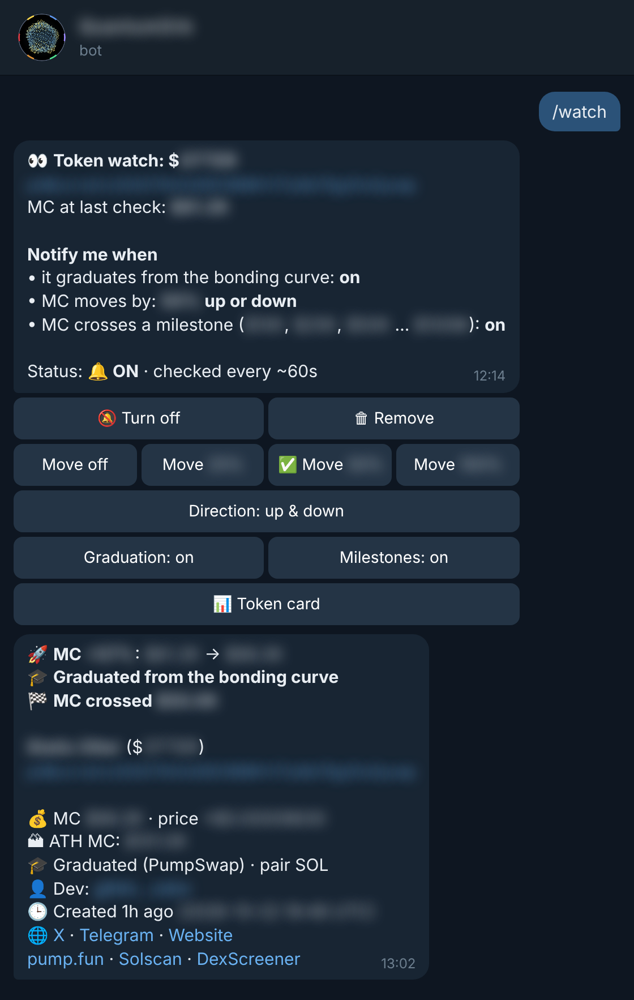<br>
<sub><b>Watch.</b> A token you follow moves, graduates and crosses a milestone: every reason in one message.</sub></td>
</tr>
<tr>
<td valign="top">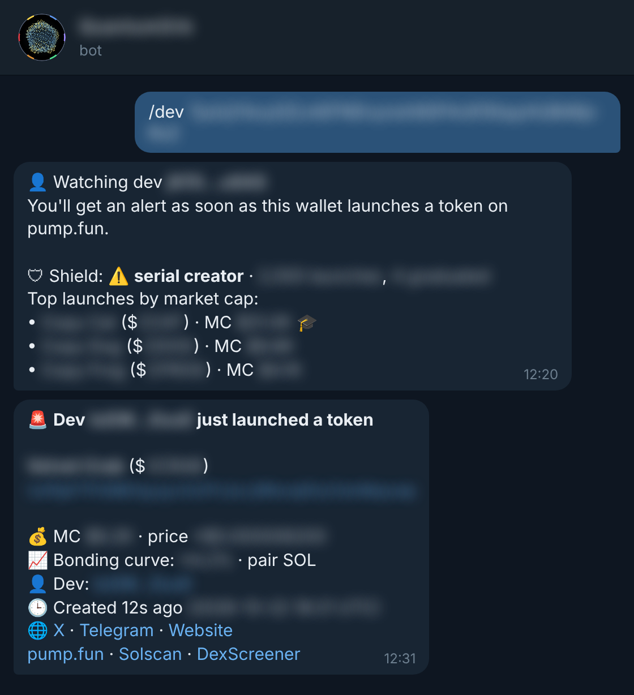<br>
<sub><b>Dev.</b> Shield's record on a serial creator, and the alert the second that wallet launches again.</sub></td>
<td valign="top">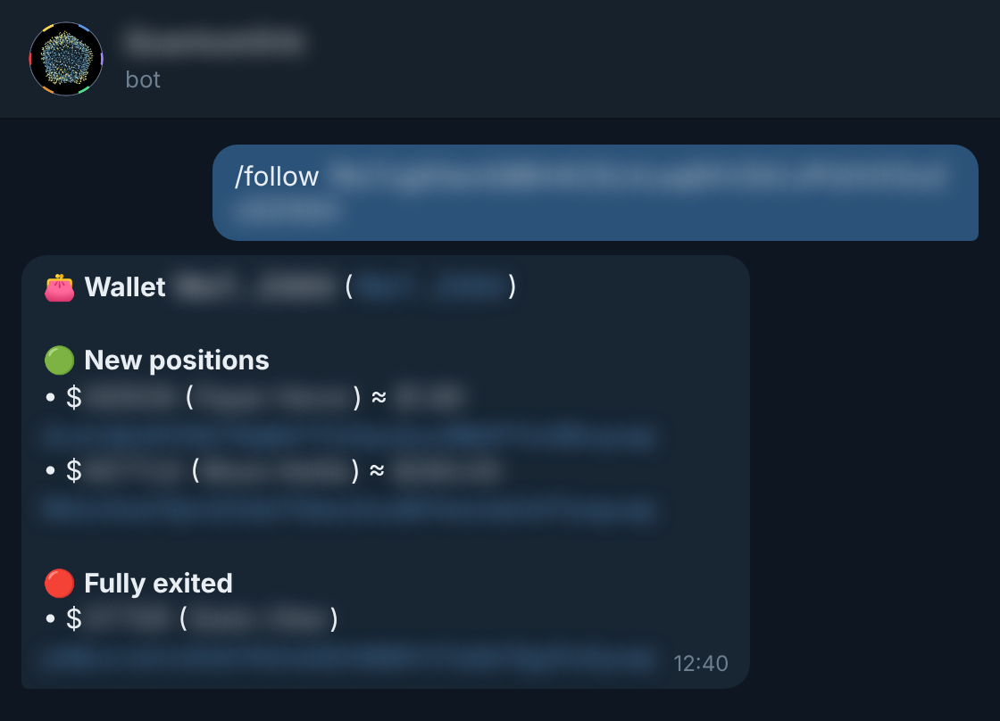<br>
<sub><b>Follow.</b> A wallet you follow opens new positions and fully exits another.</sub></td>
</tr>
</table>

## On your phone

<p align="center">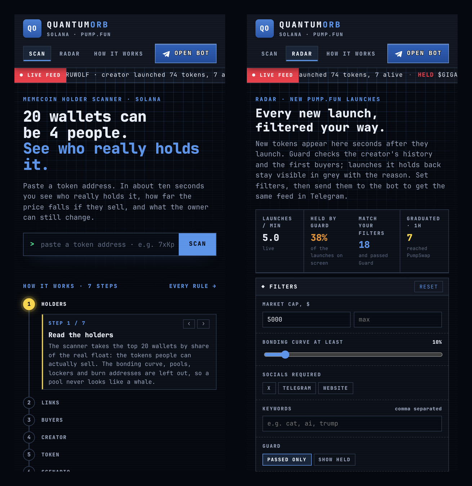</p>

## What is in this repository

| Folder | |
|---|---|
| [`rules/`](rules) | The open rules: score, operators, Guard's checks, and a command that prints a verdict |
| [`examples/`](examples) | Scan inputs with the verdict each must get: the site's example token, scans the server made, one file per rule |
| [`test/`](test) | `npm test`: every rule at its edges, and the examples against the server's results |
| [`docs/`](docs) | How QuantumOrb fits together, the score rule by rule, Guard |
| [`assets/`](assets) | The banner and the screens above |
| [`.github/`](.github) | Issue templates |

What stays closed: reading the chain (holders, entries, links between wallets), the launch stream, the
site, the API and the bot. [`docs/architecture.md`](docs/architecture.md) shows where the line is.
What changed and when: [`CHANGELOG.md`](CHANGELOG.md).

## Limits

- QuantumOrb only reads public on-chain data. It never asks for keys or seed phrases and never touches funds.
- It sees wallets, not people. Two wallets of one person with no on-chain connection look independent.
- A CLEAN score is not a promise. Liquidity, sentiment and the dev's off-chain plans are outside what it can read.
- Nothing here is financial advice.

---

<sub>Screens are from a development build running on simulated data, so every token, wallet and figure
on them is made up. Most of QuantumOrb's source is closed; this repository is its public page, and the
rules that decide a verdict are open in it.
Found a bug or have an idea? <a href="https://github.com/QunatOrb/QuantOrb/issues">Open an issue</a>. © 2026 QuantumOrb. All rights reserved.</sub>
