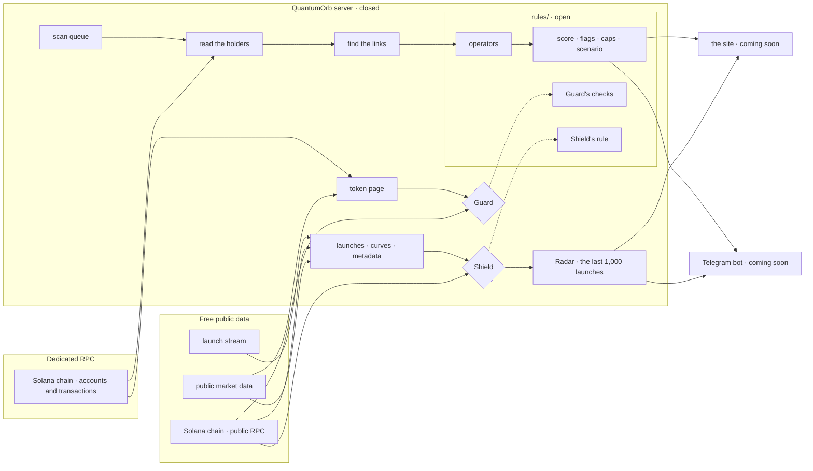

# How QuantumOrb fits together

QuantumOrb is one server, one site and one Telegram bot. The server watches every new pump.fun launch,
checks who made it, and runs scans on demand; the site and the bot read from it.

## Two kinds of work, two kinds of data

**Everything live runs on free public data.** New launches come from a public launch stream; the curve,
market cap, name and ticker of each launch are read straight from the chain; socials come from the
token's own metadata; trades in the last 5 minutes and market caps after graduation come from public
market data. Shield reads the creator's pump.fun record from the chain too. Nothing on the Radar, the
grid or the home page costs a paid call, and none of it depends on pump.fun's own API.

**Scans and token pages read the chain through a dedicated RPC.** That is where the cost is: the top
holders, how each wallet got in, the links between them, the first 20 buyers, the dev wallet, owner powers
and the holder count. A token page's market figures (price, liquidity, volume, market cap and FDV) come
from public pools that are checked to belong to this exact token.

## What happens in a scan

1. **Holders.** The top 20 wallets by share of the real float. The bonding curve, pools, lockers and
   burn addresses are left out, so a pool never looks like a whale.
2. **Each wallet.** Bought or received, when it got in, how much it paid, whether it sold since, and how
   many tokens it traded before this one (from none to 100+). Wallets down to 0.2% of float are read in
   full; a long history is read from its first transaction.
3. **Links.** The same buy transaction, tokens from one ordinary wallet, direct transfers between
   holders, packs of fresh wallets that entered together. Exchanges, routers, bridges and busy addresses
   are never used as a link.
4. **Operators.** Linked wallets merge into one operator. → [`rules/operators.js`](../rules/operators.js)
5. **The verdict.** The score, red flags, caps and the sell scenario. → [`rules/score.js`](../rules/score.js)

Steps 1–3 read the chain under a fixed budget of calls and seconds per scan. A wallet that could not be
read in time is marked unread and never counted as evidence. Steps 4–5 are the open rules in this
repository.

Around the holder scan the token page also reads: owner powers (mint and freeze authority, mutable
metadata, Token-2022 fees), who can withdraw the liquidity, all of the first 20 buyers and what each did
since, and Guard on the dev. The dev is the wallet that signed the launch, even after a community
takeover moved the creator fees elsewhere; the page then names the new fee recipient.

## What is open, and what is not

| Open, in this repository | Closed |
|---|---|
| The score, operators, flags, caps and the sell scenario | Reading holders, entries and histories from the chain |
| Guard's three checks and Shield's rule, with their thresholds | Finding links between wallets |
| Every threshold the rules use | The launch stream, the Radar and the 1,000-launch grid |
| Tests, and examples the server itself produced | The site, the API and the Telegram bot |

The open part is exactly what decides a verdict, so anyone can check that a score follows the
published rules. The closed part is what it takes to read the chain fast and cheaply enough to do it
for every launch.
