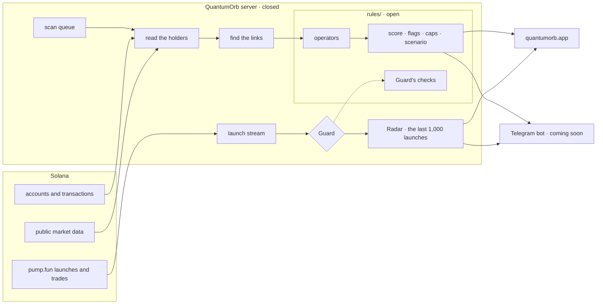

# How QuantumOrb fits together

QuantumOrb is one server, one site and one Telegram bot. The server watches the chain, screens every new
pump.fun launch and runs scans on demand; the site and the bot read from it.

## What happens in a scan

1. **Holders.** The top 20 wallets by share of the real float. The bonding curve, pools, lockers and
   burn addresses are left out, so a pool never looks like a whale.
2. **Each wallet.** Bought or received, when it got in, how much it paid, whether it sold since, and
   whether it ever traded before this token.
3. **Links.** The same buy transaction, tokens from one ordinary wallet, direct transfers between
   holders, packs of fresh wallets that entered together. Exchanges, routers, bridges and busy addresses
   are never used as a link.
4. **Operators.** Linked wallets merge into one operator. → [`rules/operators.js`](../rules/operators.js)
5. **The verdict.** The score, red flags, caps and the sell scenario. → [`rules/score.js`](../rules/score.js)

Steps 1–3 read the chain under a fixed budget of calls and seconds. A wallet that could not be read in
time is marked unread and never counted as evidence. Steps 4–5 are the open rules in this repository.

Around the holder scan the token page also reads, in parallel: owner powers (mint and freeze authority,
mutable metadata, Token-2022 fees), who can withdraw the liquidity, the first 20 buyers and what each
did since, the creator and Guard, and live buy and sell pressure.

## What is open, and what is not

| Open, in this repository | Closed |
|---|---|
| The score, operators, flags, caps and the sell scenario | Reading holders, entries and histories from the chain |
| Guard's three checks and their thresholds | Finding links between wallets |
| Every threshold the rules use | The launch stream, the Radar and the 1,000-launch grid |
| Tests, and examples the server itself produced | The site, the API and the Telegram bot |

The open part is exactly what decides a verdict, so anyone can check that a score follows the
published rules. The closed part is what it takes to read the chain fast and cheaply enough to do it
for every launch.
